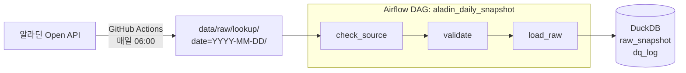
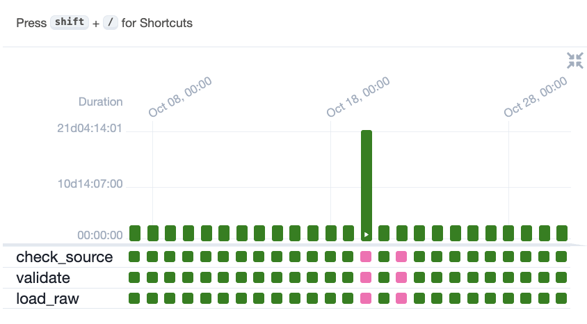

# aladin_analyzer

알라딘 Open API로 베스트셀러 도서의 가격·판매지수·중고 재고를 매일 수집하고,
Airflow로 날짜별 검증·적재하는 데이터 파이프라인입니다.

> 알라딘 Open API는 2026-10-30에 서비스가 종료되었습니다.
> 종료 전까지 27일치 일별 스냅샷(하루 2,716권)을 확보했고, 이후 이 데이터를 처리하는 파이프라인을 Airflow로 구축했습니다.

---

## 한눈에 보기

| 항목      | 내용                                                             |
| --------- | ---------------------------------------------------------------- |
| 수집 기간 | 2026-10-02 ~ 2026-10-30 (27일 수집, 2일 결측)                    |
| 추적 대상 | 주간 베스트셀러 이력(2021~2026)에서 고른 도서 패널 3,000권       |
| 적재 결과 | 27일 × 2,715권 = **73,305행**                                    |
| 품질 처리 | 잘못된 ISBN 27건 제거, 결측 날짜 2일 자동 건너뜀                 |
| 기술 스택 | Python, GitHub Actions, Apache Airflow 2.10, Docker, DuckDB, SQL |

---

## 아키텍처



### 1단계: 수집 (GitHub Actions)

`aladin_collect.py`가 API 종료일에 맞춰 3단계로 동작합니다.

| 모드       | 내용                                             |
| ---------- | ------------------------------------------------ |
| `backfill` | 2021~2026년 주간 베스트셀러 이력 일괄 수집 (1회) |
| `panel`    | 이력에서 매일 추적할 도서 3,000권 선정 (1회)     |
| `snapshot` | 패널 전체를 매일 조회해 날짜별 폴더에 저장       |

- 일일 호출 한도(4,500회) 안에서 예산을 관리하고, 중간에 끊겨도 같은 날 재실행하면 이어서 수집
- 응답에 섞인 제어문자 때문에 JSON 파싱이 깨지는 문제를 보정
- 수집 후 2,000건 미만이면 워크플로를 실패 처리

### 2단계: 처리 (Airflow)

GitHub Actions의 cron은 "매일 한 번 실행"에는 충분했지만, 데이터를 다루면서 한계가 보였습니다.

- 특정 날짜만 다시 처리하거나, 지나간 날짜를 일괄로 채우기(백필) 어려움
- 수집·검증이 한 작업에 묶여 있어 실패한 단계만 다시 돌릴 수 없음
- 날짜별 성공·실패 이력을 한눈에 보기 어려움

그래서 처리 단계를 Airflow로 옮기고, 실행 날짜(`ds`)와 날짜별 폴더(`date=YYYY-MM-DD`)를 맞물려 **같은 코드로 어떤 날짜든 다시 처리할 수 있게** 설계했습니다.

| 태스크         | 역할                                                                |
| -------------- | ------------------------------------------------------------------- |
| `check_source` | 그날 파일이 없거나 비어 있으면 **실패가 아닌 건너뛰기** 처리        |
| `validate`     | 응답을 분석용 컬럼으로 평탄화하고 품질 규칙 적용, 기준 미달 시 실패 |
| `load_raw`     | DuckDB에 날짜 단위로 적재 (재실행해도 결과 동일)                    |



---

## 설계에서 신경 쓴 점

**건너뛰기와 실패의 구분**
수집이 안 된 날(10/19, 10/21)은 오류가 아니라 데이터가 없는 날이므로 건너뜁니다.
반대로 파일은 있는데 정제 후 2,000건 미만이면 데이터 이상으로 보고 실패 처리해 확인이 필요하다는 신호를 남깁니다.

**데이터 품질 규칙**

- ISBN이 `0`이거나 빈 값인 행 제거
  패널에 ISBN이 `0`인 도서가 1권 있었고, 이 값으로 조회하면 전혀 다른 전자책이 반환되었습니다. 잘못된 키가 엉뚱한 데이터를 끌고 오는 사례라 규칙으로 걸렀습니다.
- 같은 날 같은 ISBN 중복 제거
- 날짜별 원본 건수·제거 건수·적재 건수를 `dq_log` 테이블에 기록

**멱등성 (재실행 안전)**
적재 시 해당 날짜 데이터를 지우고 다시 넣으며, 이 과정을 트랜잭션으로 묶었습니다.
같은 날짜를 몇 번 다시 돌려도 결과가 같고, 중간에 실패하면 이전 상태로 돌아갑니다.

**태스크 간 데이터 전달**
Airflow의 XCom은 작은 값 전달용이므로, 하루 2,700행 규모의 데이터는 parquet 파일로 저장하고 경로만 넘깁니다.

---

## 적재 데이터로 확인한 것

27일간 중고 재고를 판매 채널별로 집계했습니다.

| 날짜       | 회원 판매 (C2C) | 알라딘 직매입 (C2B) | 오프라인 매장 |
| ---------- | --------------: | ------------------: | ------------: |
| 2026-10-02 |          32,100 |                 656 |        11,615 |
| 2026-10-30 |          34,126 |                 816 |        12,758 |

- 중고 재고의 약 72%가 회원 간 판매(C2C)이고, 알라딘 직매입(C2B)은 2% 미만
- 27일 동안 C2C 재고는 6.3% 늘었지만 C2B는 600~900권 사이에 머무름
- 판매지수는 2,715권 중 2,501권에서 변동

```sql
SELECT snapshot_date,
       SUM(used_user_cnt)   AS c2c,
       SUM(used_aladin_cnt) AS c2b,
       SUM(used_space_cnt)  AS store
FROM raw_snapshot
GROUP BY 1
ORDER BY 1;
```

---

## 실행 방법

```bash
cd airflow
docker compose up -d
docker compose exec airflow cat /opt/airflow/standalone_admin_password.txt   # 아이디: admin
```

`http://localhost:8080`에서 `aladin_daily_snapshot`을 켜면 10/02~10/30이 날짜별로 실행됩니다.
특정 날짜만 실행하려면:

```bash
docker compose exec airflow airflow dags test aladin_daily_snapshot 2026-10-02
```

## 폴더 구조

```
aladin_analyzer/
├── .github/workflows/daily-snapshot.yml   # 일일 수집 (GitHub Actions)
├── aladin_collect.py                      # 수집 스크립트
├── data/
│   ├── raw/bestseller/                    # 주간 베스트셀러 이력
│   ├── raw/lookup/date=YYYY-MM-DD/        # 일별 스냅샷
│   ├── panel.csv                          # 추적 도서 패널
│   └── logs/collection_log.csv            # 수집 로그
└── airflow/
    ├── docker-compose.yml
    └── dags/aladin_daily_snapshot.py      # 검증·적재 DAG
```

## 다음 단계

- 판매지수·중고 재고의 전일 대비 변화를 계산하는 마트 테이블 추가
- 현업이 바로 볼 수 있는 대시보드 연결
